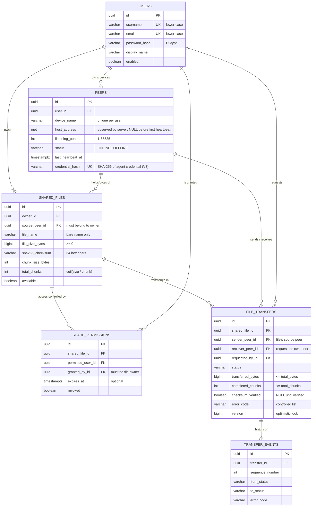
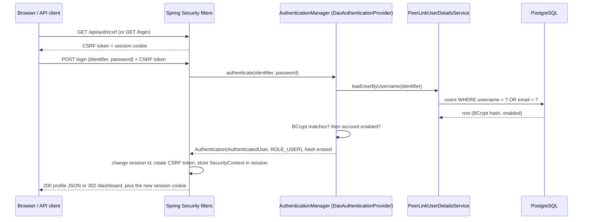
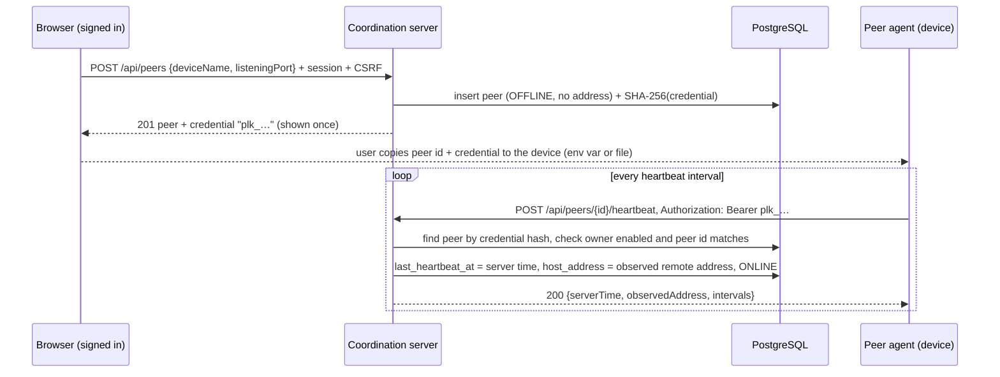

# PeerLink Architecture

PeerLink is a hybrid peer-to-peer file sharing system. A central **coordination server**
handles identity, discovery and authorization. A **peer agent** on each device moves the
actual file bytes directly to other peers over TCP sockets.

> **Core rule:** the coordination server never stores or relays file contents. It only holds
> metadata (names, sizes, checksums, permissions, transfer records).

## 1. Components

```
                    ┌───────────────────────────────────────────┐
                    │        Coordination Server (Spring Boot)  │
   Browser ───────▶ │  Thymeleaf UI · REST API · Spring Security│
   (HTTPS/HTTP)     │  Peer registry · File metadata · Tokens   │
                    └───────────────┬───────────────────────────┘
                                    │ JDBC
                                    ▼
                              ┌────────────┐
                              │ PostgreSQL │  (metadata only, schema via Flyway)
                              └────────────┘
          REST (control plane)  ▲                     ▲  REST (control plane)
                                │                     │
                    ┌───────────┴───┐             ┌───┴───────────┐
                    │ Peer Agent A  │════TCP═════▶│ Peer Agent B  │
                    │ (device A)    │ file chunks │ (device B)    │
                    └───────────────┘ (data plane)└───────────────┘
```

### 1.1 Coordination server (`coordination-server/`)

A Spring Boot 3 web application.

| Responsibility | Package |
|---|---|
| HTTP endpoints (REST and Thymeleaf pages) | `controller` |
| Request and response payloads | `dto` |
| Business logic | `service` |
| JPA entities and Spring Data repositories | `entity`, `repository` |
| Authentication and authorization rules | `security` |
| Centralized error handling | `exception` |
| Background jobs (stale peers, token expiry) | `scheduler` |
| Infrastructure beans | `config` |

The schema is owned by **Flyway** (`src/main/resources/db/migration`). Hibernate runs with
`ddl-auto: validate`, so it checks entities against the schema but never changes it. See
[section 6](#6-data-model) for the data model.

### 1.2 Peer agent (`peer-agent/`)

A plain Java 21 application with no Spring and no extra runtime dependencies. It stays small
because it runs on end-user devices.

| Responsibility | Package |
|---|---|
| Configuration (CLI flags, then environment variables, then defaults) | `config` |
| Coordination server client; socket server and client | `networking` |
| Chunked send/receive, SHA-256 verification, reassembly | `transfer` |
| Validation of transfer tokens | `security` |
| Access to user-selected files and the download directory | `filesystem` |

A browser cannot open raw TCP sockets or read arbitrary local files, so all networking and
filesystem work belongs to the agent, not the web UI.

## 2. Communication

There are two separate channels.

| Channel | Between | Protocol | Carries |
|---|---|---|---|
| **Control plane** | Browser ↔ server, agent ↔ server | HTTP + JSON (REST) | login, peer registration, heartbeats, discovery, file metadata, transfer requests, status reports |
| **Data plane** | Agent ↔ agent | TCP (`Socket` / `ServerSocket`) with mutually authenticated TLS 1.3, [PeerLink protocol v2](TCP_PROTOCOL.md) | handshake and connection test (Phase 5); file chunks (Phase 6) |

> **Protocol compatibility:** Phase 5 agents speak protocol v1 over plaintext TCP; Phase 6 agents
> speak only v2 over TLS 1.3 (ALPN `peerlink/2`) and refuse anything else. A v1 agent and a v2
> agent cannot connect to each other in either direction, so upgrade all agents together.

### 2.1 Transfer flow (implemented in Phase 6)

1. **Presence.** Each agent heartbeats with its listening port and TLS certificate fingerprint.
   The server records the address it observes.
2. **Share.** The device holding a file registers its name, size and SHA-256 (`--share`). The local
   path stays on the device.
3. **Grant.** The owner grants specific users access in the dashboard.
4. **Request.** A permitted user requests the file to one of their own devices. The server checks
   the permission and creates a `FileTransfer` in the REQUESTED state.
5. **Connect.** The receiving agent picks the request up, obtains a single-use ticket bound to
   that transfer, and connects over mutually authenticated TLS 1.3 to the sending agent. The
   sending agent redeems the ticket; the server re-checks authorization and marks the transfer
   AUTHORIZED ("accepted").
6. **Transfer.** The sender offers exactly the authorized file and streams it in 64 KiB chunks,
   re-checking authorization every 5 s. The receiver writes to a private temporary file and
   reports progress.
7. **Verify.** The receiver checks the byte count and SHA-256 against the server's metadata, then
   atomically publishes the file under a name that is never an existing file's.
8. **Report.** The receiver reports completion, which the server checks against the registered
   size and SHA-256. Either side reports failures. Every change is recorded with the reporting
   device in `transfer_events`.

See [section 10](#10-file-transfer) and [TCP_PROTOCOL.md](TCP_PROTOCOL.md).

## 3. Security model

- Passwords are hashed with BCrypt; there is no plain-text storage.
- Secrets such as the database password and token signing keys come only from environment
  variables. They are never committed.
- Users authenticate with Spring Security sessions (see [section 7](#7-authentication-and-authorization)).
  Every route is protected unless it is explicitly listed as public.
- **Peer traffic** is mutually authenticated TLS 1.3. Certificate fingerprints are distributed by
  the server.
- **Connections need a ticket.** An agent accepts a connection only with a valid, unexpired,
  single-use ticket issued for that exact pair of peers (and transfer), presented over TLS by the
  certificate the ticket names.
- **File access is limited to explicit shares.** An agent serves only files its user explicitly
  shared, identified by server-authorized id, never by path.
- **Downloads stay in the download directory.** An agent writes only there, never through a
  symbolic link, and never over an existing file.
- **No remote browsing.** There is no remote browsing or arbitrary file access.

## 4. Network scope and limitations

The first version targets peers on the **same local network**, where every agent can reach the
others directly by LAN IP and port.

Peers on different networks usually sit behind NAT routers or firewalls that block unsolicited
inbound connections. Supporting them would need extra infrastructure, which is out of scope:

- NAT traversal (for example STUN or hole punching),
- a relay service (TURN-style) for peers that cannot connect directly, or
- manual port forwarding or a VPN.

Firewalls on each device must allow inbound TCP on the agent's listen port (default `9090`).

## 5. Build structure

`peerlink/pom.xml` is a Maven aggregator. It inherits `spring-boot-starter-parent`, so both
modules share one consistent set of managed dependency and plugin versions. Each module builds,
tests and runs independently:

- `coordination-server` produces an executable Spring Boot jar.
- `peer-agent` produces a plain executable jar, `peer-agent.jar`.

The modules share no code: they communicate only over HTTP. If they later need shared protocol
types, a small `peerlink-common` module can be added.

## 6. Data model

### 6.1 Metadata, not contents

PostgreSQL stores only **metadata and records**:

- **Stored:** accounts, devices, file names, sizes, SHA-256 checksums, chunk layout,
  permissions and transfer progress.
- **Never stored:** file bytes, local filesystem paths, plaintext passwords, transfer tokens.

The peer agent keeps the mapping from file ID to local path on its own device. The server only
knows a bare file name, and the database rejects any name containing `/`, `\`, `.`/`..` or
control characters.

### 6.2 Entity-relationship diagram



Every table uses a UUID primary key and `timestamptz` columns stored in UTC (`created_at` on
all tables; `updated_at` on every table except `transfer_events`).

### 6.3 Tables

| Table | Purpose |
|---|---|
| `users` | Registered accounts. Stores only a BCrypt password hash. Username and email are unique and stored in lower case, so uniqueness ignores case. Accounts are disabled, not deleted. |
| `peers` | A user's devices running the peer agent. A user can have many, with unique device names. `host_address` is a PostgreSQL `inet` holding the address the **server observed**, never a self-reported one. A peer counts as online only while `last_heartbeat_at` is recent; the stored `status` is a cache that a bulk query resets for stale peers. Since V3 it also holds the SHA-256 hash of the device's agent credential (see section 8). |
| `shared_files` | Metadata for a file the user explicitly chose to share from one of their devices. `total_chunks` is checked to equal `ceil(file_size_bytes / chunk_size_bytes)`. `available = false` hides a file without losing its history. |
| `share_permissions` | Lets a specific user request a specific file. One row per (file, user). Supports revocation (`revoked`, `revoked_at`) and optional expiry. Possession of a file ID is never authorization: a transfer requires the owner or an active permission (`SharePermissionRepository.existsActivePermission`). |
| `file_transfers` | One transfer of a file from its source peer to a receiving peer: status, byte and chunk progress, checksum verification result, controlled error code and timestamps. `@Version` provides optimistic locking, because both peers report progress. |
| `transfer_events` | Append-only audit trail: one row per status change, numbered per transfer. Written automatically by `FileTransfer` through cascade-persist. |

### 6.4 Integrity rules enforced by PostgreSQL

The application validates input with Bean Validation (on DTOs and entities). The database
enforces the same rules again, so a bug or a manual SQL change cannot corrupt data.

| Rule | Constraint |
|---|---|
| Unique usernames and emails | `uk_users_username`, `uk_users_email` |
| One permission per file and user | `uk_share_permissions_file_user` |
| Valid TCP port (1–65535) | `ck_peers_listening_port` |
| Valid IP address | `inet` column type |
| File size ≥ 0; checksum is 64 lower-case hex characters | `ck_shared_files_size`, `ck_shared_files_checksum` |
| No paths in file names | `ck_shared_files_file_name` |
| Progress within bounds | `ck_file_transfers_bytes`, `ck_file_transfers_chunks` |
| COMPLETED requires a verified checksum and full progress | `ck_file_transfers_completed_verified` |
| FAILED requires a controlled error code | `ck_file_transfers_failed_has_error`, `ck_file_transfers_error_code` |
| A file's source peer belongs to its owner | composite FK `fk_shared_files_source_peer_owner` |
| Only the file owner grants permissions | composite FK `fk_share_permissions_granted_by_owner` |
| The sender is the file's source peer | composite FK `fk_file_transfers_file_sender` |
| The receiver is one of the requester's own peers | composite FK `fk_file_transfers_receiver_requester` |

The composite foreign keys reference `UNIQUE (id, user_id)` style constraints on the parent
table. This is how "X belongs to Y" rules are expressed in SQL without triggers.

### 6.5 Deletion policy

Foreign keys use `ON DELETE RESTRICT`, so transfer history and other users' records can never be
erased by a cascade. The only exceptions are `share_permissions` rows: they are deleted together
with their file or their recipient, because a permission means nothing without either.
Day-to-day "deletes" are soft:

- `users.enabled = false` disables an account.
- `shared_files.available = false` hides a file.
- `share_permissions.revoked = true` revokes access.

### 6.6 Transfer lifecycle

`TransferStatus` defines the legal transitions:

- REQUESTED → AUTHORIZED ("accepted" by the sending agent) → IN_PROGRESS → COMPLETED
- REQUESTED or AUTHORIZED → REJECTED, when a peer declines before any data (for example, too
  large, no space, file gone or busy)
- Any non-terminal status → FAILED or CANCELLED
- COMPLETED, REJECTED, FAILED and CANCELLED are terminal

`FileTransfer` exposes only methods that follow these rules: `authorize`, `start`,
`recordProgress`, `completeWithVerifiedChecksum`, `failChecksumVerification`, `fail`, `reject`
and `cancel`. Each method appends a `TransferEvent`, including the peer whose agent reported the
change (V5). Progress must stay within bounds and can never
go backwards. A transfer can only complete once all bytes and chunks are recorded, and the
caller must invoke the completion method only after the receiver has verified the SHA-256
checksum. `TransferService` (users) and `TransferAgentService` (agents) call these methods
inside `@Transactional` boundaries (section 10).

### 6.7 Migrations

- Migrations live in `coordination-server/src/main/resources/db/migration` and run automatically
  at startup.
  - `V1__baseline.sql` starts the version history.
  - `V2__create_core_entities.sql` creates the six core tables.
  - `V3__peer_presence_and_agent_credentials.sql` adds agent credentials and presence
    constraints to `peers`.
  - `V4__connection_tickets.sql` adds `connection_tickets` for direct peer connections
    (section 9).
  - `V5__file_transfer_and_peer_tls.sql` adds TLS fingerprints, binds tickets to transfers, adds
    the REJECTED status and new error codes, and records the reporting peer on transfer events
    (section 10).
- **Never edit a migration once it has been applied** to a database that is kept. Flyway
  checksums each script and refuses to start if one has changed. Make every change in a new
  `V<n>__description.sql`.
- Hibernate only validates (`ddl-auto: validate`). If an entity and the schema disagree, the
  application fails at startup rather than silently changing the schema.
- The test suite runs every migration against a real PostgreSQL 16 container and checks every
  constraint above.

## 7. Authentication and authorization

### 7.1 Components

| Component | Responsibility |
|---|---|
| `security/SecurityConfig` | Two filter chains (API and web), the BCrypt `PasswordEncoder`, the `AuthenticationManager`, the CSRF token store, the security-context store and the session strategy |
| `security/PeerLinkUserDetailsService` | Loads a `User` by username **or** email through `UserRepository` |
| `security/AuthenticatedUser` | Session principal: user id, username and `ROLE_USER`. The password hash is erased after authentication. |
| `security/SessionLoginService` | JSON login: authenticates, rotates the session id and CSRF token, and saves the security context in the session |
| `security/ApiSecurityErrorHandler` | JSON 401/403 for `/api/**` |
| `security/PeerCredentialService`, `PeerAgentAuthenticationFilter` | Peer-agent credentials: issue, hash and verify bearer credentials (see [section 8](#8-peers-presence-and-discovery)) |
| `service/RegistrationService` | Validates input, checks uniqueness, hashes the password and saves the `User` in one transaction |
| `service/AccountService` | Reads the signed-in user's own profile |
| `exception/ApiExceptionHandler`, `ApiRoutingExceptionHandler` | Turn errors into RFC 9457 problem details with a stable `code` |

There is no second user table: the security layer reads the Phase 2 `users` table through the
existing `User` entity and repository.

### 7.2 Filter chains

| | API chain (`/api/**`, order 1) | Web chain (everything else, order 2) |
|---|---|---|
| Public | `GET /api/health`, `GET /api/auth/csrf`, `POST /api/auth/{register,login,logout}` | `/`, `/login`, `/register`, `/error`, `/css/**`, `/js/**`, `/images/**` |
| Peer agents | only `POST /api/peers/*/heartbeat` and `POST /api/peers/*/connections[/redeem, /*/outcome]`, with `ROLE_PEER_AGENT` from a bearer credential | n/a |
| Protected | everything else needs `ROLE_USER` (`/api/admin/**` needs `ROLE_ADMIN`) | everything else |
| Not signed in | 401 JSON `UNAUTHENTICATED` | 302 to `/login` (the original page is restored after sign-in) |
| Not permitted | 403 JSON `FORBIDDEN` | 403 error page |
| Login | `POST /api/auth/login` (JSON) | Spring form login, `POST /login` |
| Logout | `POST /api/auth/logout` → 204 | `POST /logout` → `/login?logout` |

Both chains share one HTTP session, one CSRF token store and one `AuthenticationManager`. Signing
in on either side therefore authenticates both, and logging out of either ends the session.

### 7.3 Sign-in flow



The password is checked **before** the account status. A wrong password always gets the generic
`INVALID_CREDENTIALS` response, whether or not the account exists or is disabled. If the account
does not exist, `DaoAuthenticationProvider` still runs a BCrypt comparison, so response timing
does not reveal it either.

### 7.4 Authorization boundaries

- **Identity comes from the server.** Controllers get the caller from the session-backed
  `SecurityContext` (`@AuthenticationPrincipal AuthenticatedUser`). They never use a user id from
  a path, query string or JSON body to decide who the caller is. `/api/auth/me` ignores any
  `userId` parameter.
- **Own data only.** `AccountService` returns the profile of the session's user id. There is no
  endpoint for reading another user's account details.
- **Later phases** will build ownership checks for peers, files, permissions and transfers on the
  session's user id, through the existing ownership-scoped repository methods
  (`findByIdAndUser`, `findByIdAndOwner`, `existsActivePermission`) inside `@Transactional`
  services.
- **Nothing sensitive leaves the server.**
  - Password hashes exist only in the `users` table and, briefly, in memory during sign-in.
  - DTOs and `toString()` methods never contain the hash or plaintext.
  - Error responses never include stack traces, SQL, submitted values or session ids.

### 7.5 Known limitations

- **Disabling an account** blocks new sign-ins and immediately stops that user's peer agents
  (their credentials are rejected), but does not end the user's existing browser sessions.
  Ending sessions on disable needs a session registry, which is planned with admin features.
- **No brute-force protection yet:** there is no rate limiting or account lockout on the login
  endpoints.
- **Registration reveals whether an email is registered** through the `EMAIL_TAKEN` response. This
  is the usual trade-off for clear sign-up errors; adding email verification would remove it.
- **Sessions are kept in memory:** see the README's production notes.

## 8. Peers, presence and discovery

### 8.1 Device registration and agent credentials

A browser session cannot be handed to a headless agent, and the agent must never hold the user's
password. Each peer therefore gets its own **agent credential**:



- **The credential** is `plk_` followed by 256 bits from `SecureRandom`, base64url-encoded.
  - Only its SHA-256 hash is stored (`peers.credential_hash`, unique and format-checked). A fast
    hash is appropriate here, unlike for passwords, because the secret is random and long enough
    that it cannot be guessed. It also lets the server find the peer through a unique index.
  - The plaintext appears exactly once, in the registration or rotation response.
    `AgentCredentialResponse.toString()` masks it, and it is never logged or stored.
- **Scope:** `PeerAgentAuthenticationFilter` turns a valid bearer credential into a
  `PeerAgentAuthenticationToken` with only `ROLE_PEER_AGENT`. That role is accepted solely on
  the heartbeat and connection-ticket endpoints. The services also require the credential's
  peer to match the URL's peer.
  - The authentication is not stored in the session.
  - A request that carries a Bearer header never falls back to a session cookie: an invalid
    credential gets 401.
- **CSRF** is skipped only for requests that carry a Bearer header. CSRF exploits credentials
  that a browser attaches automatically, such as cookies. A cross-site page cannot make the
  browser attach an `Authorization` header, because the server has no CORS configuration.
- **Revocation and rotation:**
  - `DELETE /api/peers/{id}/credential` clears the hash and marks the peer OFFLINE.
  - `POST /api/peers/{id}/credential` replaces the hash, so the old credential stops working
    immediately.
  - Disabling the owner's account also invalidates the credential, because the owner's status
    is checked on every heartbeat.

### 8.2 Presence rules

A single rule decides whether a peer is online: **online ⇔ `last_heartbeat_at ≥ now − staleTimeout`**,
using server time only. It is applied in three places that must agree, and the tests pin the
exact cut-off on each side of the boundary:

| Where | How |
|---|---|
| `Peer.isOnline(now, timeout)` | used for `status` in every `PeerResponse` |
| `PeerRepository.findOnlinePeersExcludingUser` | discovery query (`status = ONLINE AND last_heartbeat_at >= cutoff`) |
| `StalePeerSweeper` → `PeerPresenceService.markStalePeersOffline` | bulk `UPDATE … WHERE status = 'ONLINE' AND last_heartbeat_at < cutoff`, in a transaction, every sweep interval |

The sweep is housekeeping, not something correctness depends on. Reads already treat stale
peers as offline, so a missed sweep (for example while the database is briefly down) never shows
a stale peer as online. The bulk update touches only stale rows and uses the existing
`ix_peers_status_heartbeat` index. Settings live in `peerlink.peers.*` (`PeerPresenceProperties`),
and the server refuses to start if `stale-timeout` is less than twice `heartbeat-interval`.

After an agent loses connectivity, its peer keeps appearing online for up to `stale-timeout`.
Online status is never proof that a direct connection will succeed.

### 8.3 Addresses

- `peers.host_address` (`inet`) is `NULL` until the first heartbeat. A peer is registered from a
  browser, which may be a different machine, so the server has no address it could honestly
  record before then.
- At each heartbeat, the address becomes `HttpServletRequest.getRemoteAddr()`: the TCP peer
  address the server observed. Request bodies and `X-Forwarded-*` headers are ignored unless
  `server.forward-headers-strategy` is configured for a trusted proxy. IPv6 zone ids are stripped
  because `inet` cannot store them.
- The database enforces `ck_peers_online_has_address`: an ONLINE peer must have an address.
- **Discovery does not reveal addresses or ports.** A peer's address and port are returned only
  inside a connection ticket, to an agent authorized to connect (section 9).
- Since Phase 5, a heartbeat may include the agent's actual listening port (`{"listeningPort": n}`),
  which updates the registered port. The address is still never taken from the body.

### 8.4 Agent heartbeat loop

| Class | Role |
|---|---|
| `presence/PresenceClient` | interface: `sendHeartbeat(peerId, credential) → HeartbeatResult`; never throws on network errors |
| `networking/CoordinationServerClient` | implementation using `java.net.http.HttpClient`, with 5 s connection and response timeouts |
| `presence/HeartbeatLoop` | single background thread that schedules each beat after the previous one finishes, so beats never overlap |
| `presence/BackoffPolicy` | 1 s, 2 s, 4 s … capped at 60 s after consecutive failures |
| `config/AgentCredential` | holds the secret; `toString()` is masked |

How the loop reacts to each result:
- **Accepted:** schedule the next beat after the normal interval.
- **Server unreachable, or a 5xx/429 response:** retry with backoff, indefinitely, with each wait
  capped at 60 s.
- **401, 403 or 404:** stop and exit with code 3. Retrying a revoked credential cannot succeed.
- **Unexpected exception:** treated as a failure. It never ends the loop silently.

A JVM shutdown hook closes the loop on Ctrl+C or SIGTERM: the executor is shut down and given up
to 5 s to finish.

### 8.5 Schema change (V3)

`V3__peer_presence_and_agent_credentials.sql` (V2 is unchanged):
- makes `host_address` nullable, and adds `ck_peers_online_has_address`
- adds `credential_hash` and `credential_issued_at`, with `uk_peers_credential_hash` (which also
  serves as the lookup index), `ck_peers_credential_hash_format` and `ck_peers_credential_issued`

No new tables were needed: a peer has at most one current credential, so the credential lives on
`peers`.

## 9. Direct peer connections

Phase 5 adds direct, authorized TCP connections between agents, but not file transfer. The wire
format, state machines, limits and security limitations are specified in
[TCP_PROTOCOL.md](TCP_PROTOCOL.md). The step-by-step check is in
[MANUAL_TEST_PEER_CONNECTIONS.md](MANUAL_TEST_PEER_CONNECTIONS.md).

### 9.1 Why tickets

Before Phase 5, nothing let agent B tell whether a connecting socket really was peer A, or let A
tell whether it had reached the real B. Agent credentials must not be shown to other peers, so
the server brokers each connection with a **single-use connection ticket**:

| Component | Responsibility |
|---|---|
| `V4__connection_tickets.sql` / `ConnectionTicket` | Ticket record. Holds only `SHA-256(ticket)`, the source, the requesting user (composite FK: must own the source), the target, the target address and port handed out, status (`ISSUED → REDEEMED`, or `INVALIDATED`), expiry and the reported outcome. The responder proof is held only while the ticket is `ISSUED`. |
| `ConnectionTicketService` | Issue, redeem and report outcome, as described below. |
| `PeerConnectionApiController` | `POST /api/peers/{peerId}/connections`, `…/redeem`, `…/{ticketId}/outcome`, all for agents only. |
| `ConnectionProperties` | `peerlink.connections.ticket-ttl` (default 60 s). |

**Issue:**
- Only the source peer's own agent may request a ticket.
- The target must be another peer that is online by the heartbeat rule, has an observed address,
  and whose owner's account is enabled. This Phase 5 policy is exactly the discovery set plus the
  user's own devices.

**Redeem:**
- The ticket row is locked (`SELECT … FOR UPDATE`), so concurrent redemptions cannot both
  succeed; a test runs six at once and exactly one wins.
- Redemption is rejected, with one generic `403` and the reason only in the server log, when the
  ticket is:
  - unknown
  - presented to the wrong peer (the ticket is also burned)
  - already used
  - expired
  - from a source whose account was disabled or whose credential was revoked or rotated after
    the ticket was issued

**Audit:** issuing, redeeming, rejecting and reporting outcomes are all logged with ids only.

### 9.2 Agent components

| Package / class | Role |
|---|---|
| `protocol/` (`FrameIO`, `MessageCodec`, `Message`, `MessageType`, `Handshake`, `TransferMessages`, `ProtocolChannel`, `RejectReason`, `TransferError`) | Wire format only: control (`C`) and data (`D`) frames with the kind and length checked before allocation, and strict UTF-8 `key=value` messages. No sockets, no Java serialization. |
| `security/` (`TlsIdentity`, `SelfSignedCertificate`, `PeerTls`, `PinnedServerTrustManager`, `DeferredClientTrustManager`, `CertificateFingerprints`) | Per-process TLS identity and mutually authenticated TLS 1.3 with pinned fingerprints (Phase 6). |
| `security/` (`TicketIssuer`, `TicketVerifier`, `IssuedTicket`, `VerifiedTicket`) | Interfaces for obtaining and verifying tickets. Ticket and proof are masked in `toString()`. |
| `networking/CoordinationTicketAuthority` | Implements both interfaces through the coordination server. The agent credential stays here. |
| `networking/PeerListener` | `ServerSocket` bound to `--listen-host:--port` (loopback by default), with a semaphore-limited fixed worker pool. Over-limit connections get `REJECT BUSY` on a separate small thread, so the accept loop never blocks. `close()` closes the port and all connections and stops the workers. |
| `networking/InboundConnectionHandler` | Responder state machine with an overall handshake deadline (`DeadlineInputStream`) and an idle timeout. Never throws into the listener. |
| `networking/PeerConnector` | Initiator: one attempt, connect and handshake timeouts, constant-time proof check, PING/PONG, outcome report. |
| `networking/FlatJson` | Strict reader and writer for the flat JSON the agent exchanges with the server; the agent has no JSON library. |

### 9.3 Integration with the running agent

- **The listener runs alongside the heartbeat loop.** The listener has its own threads, so a slow
  or failing peer connection cannot delay or stop heartbeats.
- **If the listener cannot bind its port,** the agent exits with code 5 before it starts
  heartbeats. Otherwise the peer would appear online while being unreachable.
- **Connection tests run in a separate process.** `--connect-to=<peer>` performs one test and
  exits, so it never runs inside, or blocks, the heartbeat agent.
- **Phase 1–4 behaviour is unchanged:**
  - Without a peer configured, the agent checks the server's health and exits.
  - `--listen=false` gives an agent that heartbeats and fetches requested files but serves none.
  - Exit codes 0–3 keep their meanings; codes 4 and 5 were added in Phase 5, and 6 (`--share`
    failed) in Phase 6.
- **Phase 6 change:** peer connections are TLS-only (protocol v2). Phase 5 (v1, plaintext) agents
  and Phase 6 (v2) agents cannot connect to each other in either direction; there is no fallback.
  Ticket redemption also changed: the listener now sends the presented TLS certificate's
  fingerprint (`presentedCertificateSha256`, required), so Phase 6 agents need a Phase 6 server.

## 10. File transfer

### 10.1 Design decisions

- **Pull model.** A user requests a file *to one of their own devices*. The database enforces that
  the receiving peer belongs to the requester (composite FK, V2). The receiver's agent initiates
  the connection, so only the sending device needs to accept inbound connections.
- **Agent-side sharing.** The browser cannot read local files, and the server must not hold them.
  `--share` therefore hashes the file on the device and registers only metadata. The device keeps
  its own id → path list (`ShareIndex`, in `--data-dir`, owner-only permissions).
- **One authorization decision, evaluated everywhere.** `TransferAuthorizationPolicy` decides
  whether a user may receive a file: owner, or active permission, file still shared, both accounts
  enabled. It runs at request, ticket issue, ticket redemption, every progress report and every
  sender check.
- **Ticket binding.** A connection ticket may carry one `transfer_id`. When the sender redeems it,
  the server returns the exact transfer (file id, name, size, SHA-256) that the sender may serve.
- **TLS without a CA.** Each agent process has an ephemeral key pair, and fingerprints are
  distributed by the already-authenticated server and pinned on both sides. No private key is
  stored, no certificate authority is needed, and nothing trusts arbitrary certificates
  (section 10.4).
- **No resume.** An interrupted transfer fails (with a reason) and its partial file is deleted.
  Requesting again starts a fresh transfer.
- **Chunk-size policy: 4 KiB to 64 KiB.** The upper bound is the protocol's data frame limit; the
  lower bound keeps per-frame overhead sensible. The registration API refuses anything else (400),
  and both agents check again before connecting or serving. The entity and the V2 database check
  still allow the wider 1 B–16 MiB range they were created with; no migration was needed because
  the API is the only way files get registered. Flow control counts bytes on both sides (an
  acknowledgement every 1 MiB, an 8 MiB window), so the number of unread acknowledgements is
  bounded whatever the chunk size.
- **No unbounded blocking.** Reads have deadlines (`DeadlineInputStream`), and so do writes:
  `ConnectionWatchdog` closes the plain TCP socket of a connection whose write has blocked longer
  than its deadline (sockets have no write timeout; `SO_TIMEOUT` covers reads only). Other threads
  stop a connection the same way: cancellation, revocation, an expired authorization lease, and
  shutdown all unblock a sender stuck in a write or read, and its upload slot is released.
- **Publication is the point of no return.** Before it, any failure discards the partial file and
  the transfer is reported failed. After it, the file is never deleted and the transfer is never
  reported failed: the receiver reports completion until the server answers definitively (see
  TCP_PROTOCOL.md, "After publication"), and a sender that loses the connection after
  `TRANSFER_END` leaves the outcome to the receiver.

### 10.2 Server components

| Component | Responsibility |
|---|---|
| `V5__file_transfer_and_peer_tls.sql` | `peers.tls_certificate_sha256`; `connection_tickets.initiator_certificate_sha256` and `transfer_id`; `REJECTED` and nine new error codes; failed or rejected transfers require a code; `transfer_events.reported_by_peer_id`; an index for "next transfer for this receiver" |
| `SharedFileService` / `SharedFileApiController` (`/api/files`) | Agent registration (idempotent); owners list files, grant, list and revoke permissions, stop sharing |
| `TransferService` / `TransferApiController` (`/api/transfers`) | Users request, list, view and cancel. Visible only to the requester and the file owner. |
| `TransferAgentService` / `PeerTransferApiController` (`/api/peers/{peerId}/…`) | Agents: next pending transfer, status, progress (receiver only), complete (receiver only; checked against size and SHA-256 and re-authorized; idempotent for an identical repeat), fail, reject |
| `TransferAuthorizationPolicy` | The single authorization rule above |
| `ConnectionTicketService` | Issues transfer-bound tickets (receiver → sender, REQUESTED only, one outstanding ticket per transfer); at redemption checks the presented TLS certificate before consuming the ticket, re-checks authorization and moves the transfer to AUTHORIZED |
| `TransferSweeper` | Fails unclaimed requests (`REQUEST_EXPIRED`, 30 min) and stalled transfers (`TIMEOUT`, 3 min) |

**Hardening worth knowing:**
- A completion report whose size or checksum differs from the registered file fails the
  transfer. That failure is committed even though the request is answered with 400.
- A concurrent update (optimistic lock) is answered with 409 `CONCURRENT_MODIFICATION`; agents
  retry it.
- Completion is idempotent: the same report for an already COMPLETED transfer returns 200 and
  records nothing; a report for a transfer that ended otherwise is 409 `TRANSFER_STATE_CONFLICT`.
  A completion that arrives after access was revoked fails the transfer (`PERMISSION_DENIED`),
  committed despite the 409.
- Chunk sizes outside 4 KiB–64 KiB cannot be registered.

### 10.3 Agent components

| Class (`transfer/`) | Responsibility |
|---|---|
| `FileSharer` | `--share`: rejects symlinks, directories and over-size files; streaming SHA-256; registers metadata; records the real path in `ShareIndex` |
| `UploadSession` | Sender (`IncomingTransferHandler`): grant check, upload slots, offer from server metadata, windowed streaming, authorization lease renewed every 5 s on a checker thread (fail closed), aborting a blocked connection when stopped, source-change detection, END/COMPLETE |
| `SourceFile` | Opens the shared file (no symlinks), checks size, reads bounded chunks, detects changes (size, mtime, extra bytes) |
| `DownloadManager` | Polls for requests every 5 s (first retrying undelivered completion reports) and runs at most `--max-transfers` downloads on its own threads; on shutdown aborts their connections |
| `DownloadSession` | Receiver: pre-checks (size limit, name, chunk size, free space), ticket, connect, offer check, strict chunk checks, ACKs per MiB, progress reports, verification, final authorization check (fails closed), publish, then TRANSFER_COMPLETE and the completion report, neither of which can undo the publication |
| `CompletionReports` | Delivers completion reports: backoff retries for 60 s, a journal in the data directory, retried on every poll and after restart until the server accepts or refuses |
| `DownloadTarget` | Private temp file (`.peerlink-*.part`, exclusive create), bounded writes, fsync, size + SHA-256 check, publish by reserving the name with exclusive creation then atomic rename, delete on failure |
| `FileNames` | Validates untrusted names: a single path element, no separators, `..` or control characters, at most 255 bytes, no trailing dot or space |
| `CoordinationTransferCoordinator` | The server calls above (via `CoordinationServerClient.postJson/getJson`) |

### 10.4 TLS design

The **coordination server is the trust anchor**, just as it already is for agent credentials and
tickets:

| Who | Learns | From |
|---|---|---|
| Server | each listener's certificate fingerprint | the agent's authenticated heartbeat |
| Server | the initiator's certificate fingerprint | the authenticated ticket request (stored on the ticket) |
| Initiator | the target's fingerprint | the ticket response; pinned during the TLS handshake |
| Listener | the initiator's fingerprint | the ticket redemption, which the server performs only for the presented certificate's fingerprint; compared again before `HELLO_ACK` |

- **Algorithms:** TLS 1.3 only, ALPN `peerlink/2` required during the handshake (both trust
  managers refuse otherwise), EC P-256 keys.
- **Certificates:** self-signed X.509 v3, encoded by `SelfSignedCertificate` (the JDK has no
  public certificate-builder API) and signed with `java.security.Signature`. They are parsed back
  by `CertificateFactory`, which rejects anything malformed.
- **Mutual authentication is a combination of both checks.** The initiator rejects any server
  certificate other than the pinned one. The listener requires a client certificate during the
  handshake, then refuses the connection unless it is the one bound to the ticket.
- **Remaining trust assumption:** the agent↔server channel must be authentic. Use HTTPS in
  production; the agent warns about plain HTTP to a non-loopback server.
