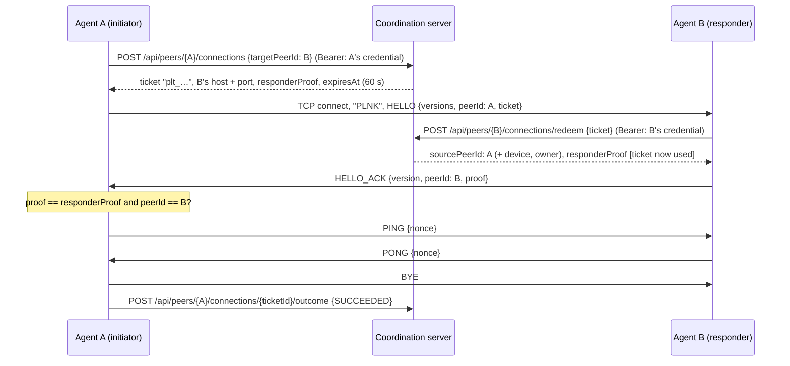

# PeerLink Peer Protocol, version 1

This document specifies how two PeerLink peer agents establish a **direct TCP connection** and
prove to each other who they are. Version 1 can only establish and test a connection.
**Version 1 carries no file data**; file transfer is added in Phase 6.

The coordination server authorizes connections but **never carries peer traffic**. It is not a
relay or a proxy.

## 1. Overview



## 2. Transport and framing

- TCP. In version 1 there is **no TLS**; see [section 8](#8-security-properties-and-limitations).
- Immediately after connecting, the initiator sends the 4-byte ASCII **magic** `PLNK`. The
  responder closes any connection that starts with anything else, such as an HTTP request.
- After the magic, both sides exchange **frames**:

  ```
  frame  = length payload
  length = 4-byte unsigned big-endian integer, 1 ≤ length ≤ 4096
  payload = exactly `length` bytes
  ```

  The receiver reads the 4-byte length and **validates it before allocating any buffer**. A
  length of 0 is `MALFORMED`. A length above 4096 is `FRAME_TOO_LARGE`, and the payload is never
  read.
- If a frame header or payload is cut short because the connection closed, the connection is
  closed.

## 3. Message encoding

A payload is **strict UTF-8 text**: one `key=value` per line, every line ending in `\n` (LF only).
The first line is always `type=<MESSAGE_TYPE>`.

```
type=HELLO\n
versions=1\n
peerId=7cb33355-9512-4efd-a86b-4272a1f31e96\n
ticket=plt_…\n
```

A payload is rejected with `MALFORMED` if any of these rules is broken:

| Rule | Limit |
|---|---|
| Valid UTF-8 | malformed byte sequences are rejected |
| Final line break | required; `\r` is not allowed |
| Fields per message | at most 16, plus `type` |
| Key | `[a-zA-Z][a-zA-Z0-9]{0,31}` |
| Value | 1–256 characters, no control characters |
| Duplicate keys | rejected |
| Fields | only those defined for the message type (below) |

An unknown `type` is rejected with `UNKNOWN_MESSAGE_TYPE`.

No Java serialization and no general-purpose parser is involved. Decoding produces only strings,
which are then validated field by field.

## 4. Message types (version 1)

| Type | Direction | Fields | Meaning |
|---|---|---|---|
| `HELLO` | initiator → responder | `versions` (comma list of 1–8 numbers), `peerId` (lower-case UUID), `ticket` (`plt_` + 43 base64url chars) | Opens the handshake |
| `HELLO_ACK` | responder → initiator | `version`, `peerId`, `proof` (43 base64url chars) | Handshake accepted |
| `REJECT` | responder → initiator | `reason` | Refused before the handshake completed; the connection is then closed |
| `PING` | initiator → responder | `nonce` (1–64 base64url chars) | Connection test |
| `PONG` | responder → initiator | `nonce` (echoed) | Connection test reply |
| `BYE` | either | optional `reason` | Graceful close after the handshake |

`reason` values:
`MALFORMED`, `FRAME_TOO_LARGE`, `UNKNOWN_MESSAGE_TYPE`, `UNEXPECTED_MESSAGE`,
`UNSUPPORTED_VERSION`, `UNAUTHORIZED`, `BUSY`, `UNAVAILABLE`, `TOO_MANY_MESSAGES`,
`INTERNAL_ERROR`.

### Version negotiation

`HELLO.versions` lists every version the initiator supports. The responder picks the highest
version it also supports and returns it in `HELLO_ACK.version`. If there is none in common, it
sends `REJECT reason=UNSUPPORTED_VERSION`. The initiator refuses any `HELLO_ACK.version` it did
not offer.

Future versions must keep `HELLO` parseable by version-1 responders, so that negotiation still
works.

## 5. State machines

**Responder** (`InboundConnectionHandler`):

```
ACCEPTED ── read "PLNK" ──▶ AWAIT_HELLO ── HELLO ──▶ VERIFYING
VERIFYING: negotiate version → redeem ticket with server → ticket.source == HELLO.peerId?
   ok  ──▶ send HELLO_ACK ──▶ ESTABLISHED
   any failure ──▶ send REJECT(reason) ──▶ CLOSED
ESTABLISHED: PING → PONG (at most 16 per connection, then BYE TOO_MANY_MESSAGES)
             BYE  → CLOSED
             anything else → BYE UNEXPECTED_MESSAGE → CLOSED
```

**Initiator** (`PeerConnector`):

```
request ticket (server) ─▶ CONNECTING ─ connect ─▶ send "PLNK" + HELLO ─▶ AWAIT_ACK
AWAIT_ACK: REJECT → failed (REJECTED_BY_PEER)
           HELLO_ACK: version offered? peerId == target? proof == responderProof (constant time)?
              no  → send BYE UNAUTHORIZED → failed (PEER_IDENTITY_MISMATCH / PROTOCOL_ERROR)
              yes → send PING(nonce) → PONG(nonce)? → send BYE → SUCCEEDED
report outcome to server (best effort)
```

## 6. Timeouts and limits

| Setting | Value | Applies to |
|---|---|---|
| Connect timeout | 5 s | initiator's TCP connect |
| Handshake deadline | 15 s **total** | responder: from accept until `HELLO_ACK`; initiator: whole exchange |
| Idle timeout | 30 s per message | responder, after the handshake |
| Max frame | 4096 bytes | both |
| Max connection tests | 16 per connection | responder |
| Max simultaneous connections | 8 (`--max-connections`, 1–64) | responder; extra connections get `REJECT BUSY` |
| Ticket lifetime | 60 s (`PEER_CONNECTION_TICKET_TTL`, 5 s–10 min) | server |

Deadlines are **overall** deadlines, not per-read timeouts. Before every read, the remaining time
is applied as the socket timeout, so a client that sends one byte at a time cannot keep a worker
busy past the deadline.

## 7. Authorization (connection tickets)

The long-lived agent credential (`plk_…`) authenticates an agent **only to the coordination
server**. It is never sent to another peer and is never used as a peer-to-peer secret.

| Step | Who | Check |
|---|---|---|
| Issue: `POST /api/peers/{A}/connections` | A's agent (Bearer `plk_` of A) | The credential belongs to A. The target is not A, is **online** by the heartbeat rule, has an observed address, and its owner's account is enabled. Otherwise 404 (a missing peer and an unavailable peer look the same) or 400 (self). |
| Present: `HELLO.ticket` | A → B | Format check only; B cannot judge the ticket itself. |
| Redeem: `POST /api/peers/{B}/connections/redeem` | B's agent (Bearer `plk_` of B) | Under a row lock: the ticket exists, its target **is B**, it is still `ISSUED` (never used), it has not expired, and A's account is enabled and A's credential has not been revoked or rotated since the ticket was issued. On success the ticket becomes `REDEEMED`. A ticket presented to the wrong peer, expired, or revoked is **invalidated**. Every failure gives the same `403 CONNECTION_TICKET_INVALID`; the reason is only in the server log. |
| Identity | B | `HELLO.peerId` must equal the source the server returned. A peer claiming someone else's id is rejected. |
| Mutual authentication | A | `HELLO_ACK.proof` must equal the `responderProof` A received at issue. Only an agent holding **B's** credential can obtain that proof (by redeeming), so A detects an impostor listening at B's address. |
| Outcome: `POST /api/peers/{A}/connections/{id}/outcome` | A's agent | Only the source can report, and only once. |

- **What the server stores:** only `SHA-256(ticket)`. The responder proof is kept until the
  ticket is redeemed or invalidated, and is then cleared (V4 migration, `connection_tickets`).
- **Logging:** ticket values and proofs are never logged by the server or the agents. Records
  that might be logged mask them in `toString()`.
- **Policy:** in Phase 5, a user's peer may contact any peer that discovery would show: online
  peers of enabled accounts, plus the user's own other devices. Phase 6 will narrow this to
  transfers that a share permission allows.

## 8. Security properties and limitations

**Provided:**
- Knowing a peer's id, address or port is not enough to connect: every connection needs a fresh,
  server-issued, single-use ticket scoped to one source and one target.
- The responder learns the initiator's identity from the server, not from the socket.
- The initiator verifies the responder through the server-brokered proof.
- **Replay** of a ticket is rejected, because it is single-use with an atomic redemption.
- **Expired, revoked or misdirected** tickets are rejected.
- Malformed, oversized, unknown or out-of-order messages are rejected without crashing the
  listener.
- Resources are bounded: connection limit, worker pool, frame size, deadlines, and pings per
  connection.

**Not provided (documented limitations):**
- **No encryption or integrity protection on the TCP stream.** Anyone who can observe the LAN
  sees handshake messages. A ticket seen in transit cannot be replayed once used, but an
  **active man-in-the-middle** (for example via ARP spoofing) could forward the handshake in
  real time and relay or alter the session. TLS with channel binding is needed to close this gap,
  and file content must not be considered confidential until then.
- **A redeemed ticket is not bound to the TCP connection**, for the same reason.
- **The server must be reachable by the responder.** If it is not, the responder cannot verify
  tickets and fails closed with `REJECT UNAVAILABLE`.
- **Addresses are what the server observed.** NAT, VPNs and multiple interfaces can make them
  unreachable. There is no NAT traversal.
- **Online status is not reachability.** A peer can be online while its listener is
  firewalled, bound to loopback, or listening on a different port.
- **No rate limiting** on ticket issuance, and **no retention limit** on `connection_tickets`
  rows.
